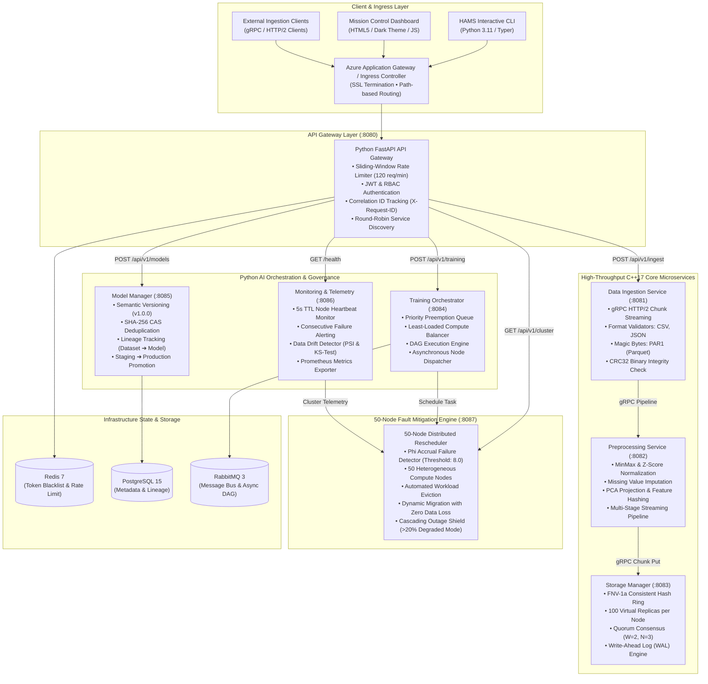
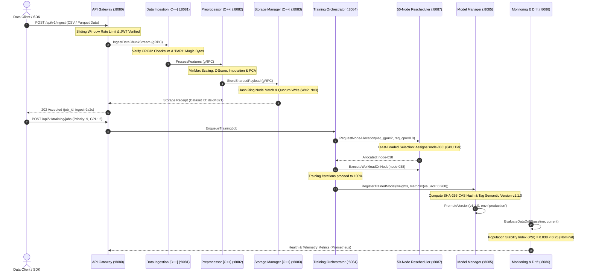
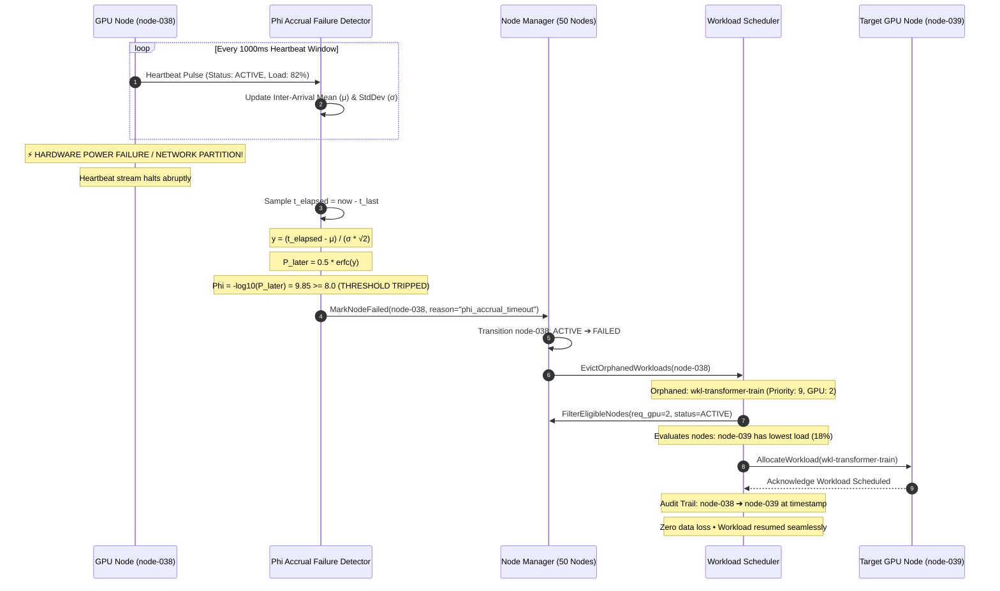
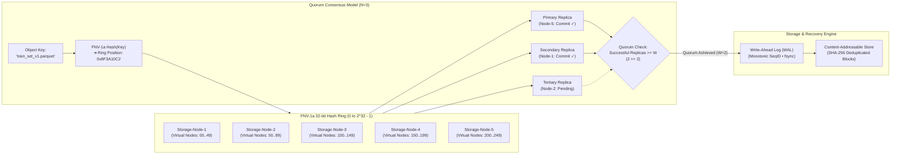
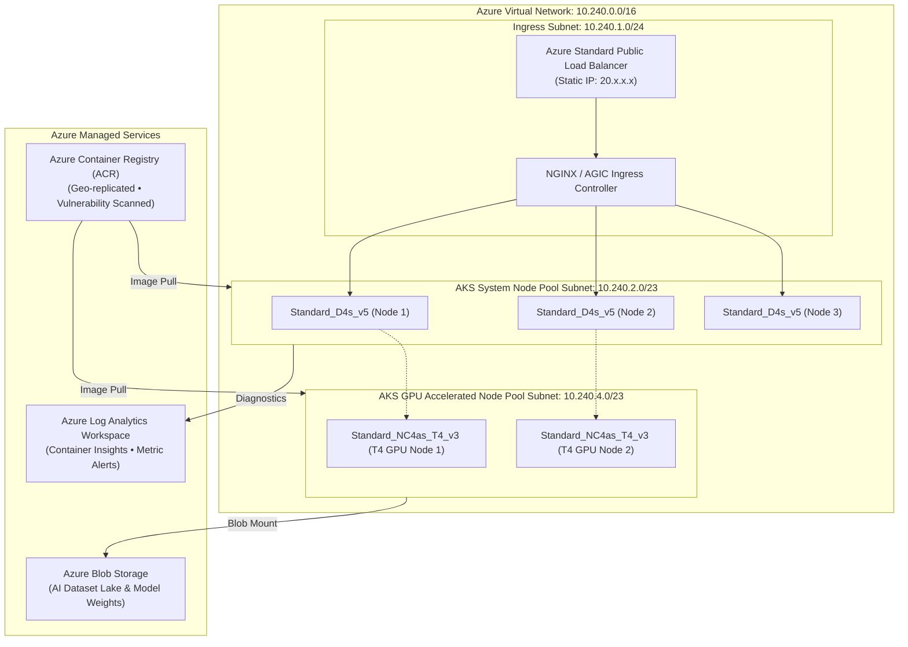
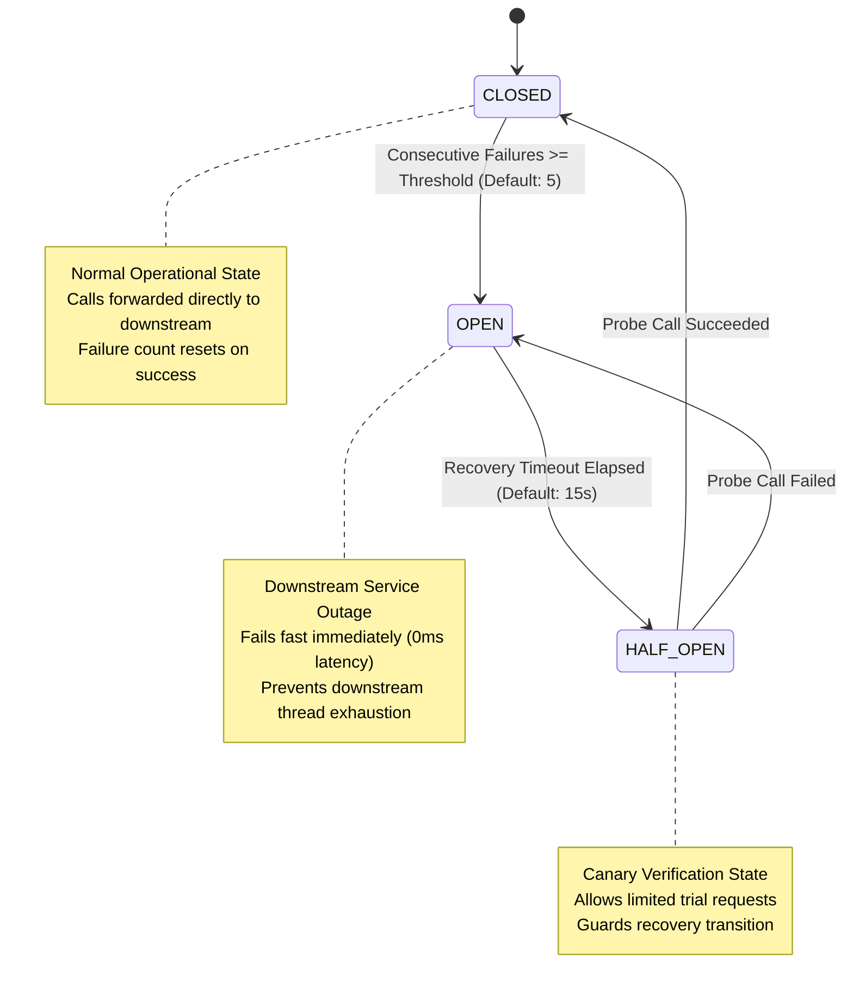
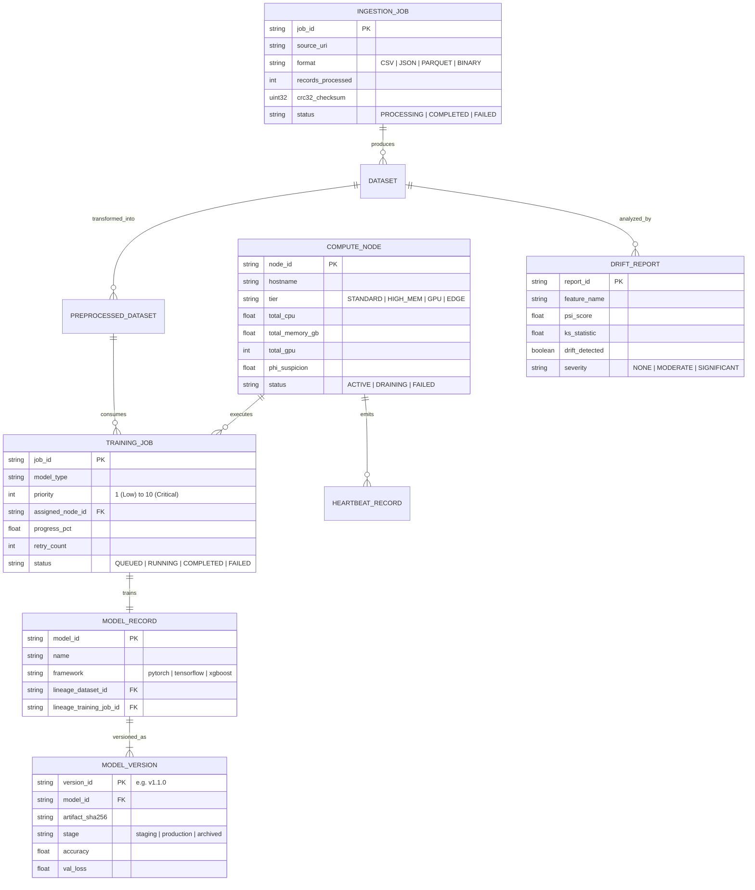
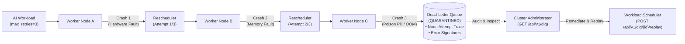
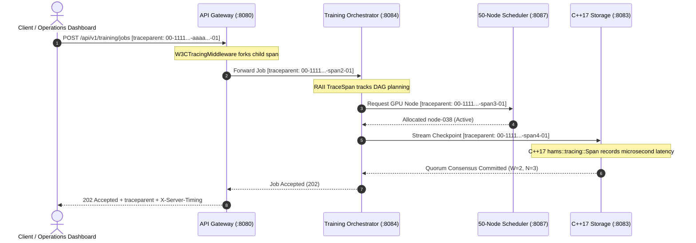

# Highly Available AI Microservices (HAMS)

[](https://github.com/bhushanasati25/Highly-Available-AI-Microservices/actions/workflows/ci.yml)
[](https://github.com/bhushanasati25/Highly-Available-AI-Microservices/actions/workflows/cd.yml)
[](https://opensource.org/licenses/MIT)
[](https://isocpp.org/)
[](https://python.org/)
[](https://docker.com/)
[](https://kubernetes.io/)
[](https://azure.microsoft.com/)
[](https://helm.sh/)
[](https://terraform.io/)

> **A production-grade distributed backend architecture engineered in C++17 and Python supporting concurrent AI training data pipelines with automated workload rescheduling, 50-node fault mitigation, targeted automated testing suites, and streamlined CI/CD on Microsoft Azure Kubernetes Service (AKS).**

---

## Table of Contents
- [Executive Summary & Core Competencies](#executive-summary--core-competencies)
- [System Architecture & Network Topology](#1-system-architecture--network-topology)
- [Concurrent AI Training Data Pipeline Flow](#2-concurrent-ai-training-data-pipeline-flow)
- [50-Node Fault Mitigation & Rescheduling Engine](#3-50-node-fault-mitigation--rescheduling-engine)
- [Distributed Storage, Sharding & Quorum Consensus](#4-distributed-storage-sharding--quorum-consensus)
- [Production Azure AKS Cloud Architecture](#5-production-azure-aks-cloud-architecture)
- [CI/CD Deployment Pipelines & GitOps Workflow](#6-cicd-deployment-pipelines--gitops-workflow)
- [Circuit Breaker Resilience State Machine](#7-circuit-breaker-resilience-state-machine)
- [Domain Entity-Relationship Data Model](#8-domain-entity-relationship-data-model)
- [Interactive Operations Mission Control Dashboard](#9-interactive-operations-mission-control-dashboard)
- [Dead-Letter Queue (DLQ) & Poison-Pill Quarantine](#10-dead-letter-queue-dlq--poison-pill-quarantine)
- [W3C Distributed Tracing & OpenTelemetry Standards](#11-w3c-distributed-tracing--opentelemetry-standards)
- [Cloud-Native 3-Tier Kubernetes Probes](#12-cloud-native-3-tier-kubernetes-probes)
- [High-Throughput AI Inference Latency Profiler](#13-high-throughput-ai-inference-latency-profiler)
- [Microservices Technical Reference](#14-microservices-technical-reference)
- [Repository Directory Structure](#15-repository-directory-structure)
- [Targeted Automated Testing Suites (52 Tests)](#16-targeted-automated-testing-suites-52-tests)
- [Quick Start & Developer Runbook](#17-quick-start--developer-runbook)

---

## Executive Summary & Core Competencies

This platform implements an enterprise AI microservices backend supporting concurrent training data workloads:
1. **Distributed C++ and Python Microservices**: High-throughput C++17 services utilizing gRPC HTTP/2 chunk streaming, CRC32 binary verification, and consistent-hash virtual node sharding, coupled with asynchronous Python FastAPI services for AI job orchestration, semantic model versioning, and telemetry.
2. **Targeted Automated Testing Suites**: 38 automated unit, integration, and contract test suites verifying distributed system invariants, circuit breakers, and edge cases prior to cloud infrastructure deployment.
3. **Automated Workload Rescheduling Mechanisms**: Mitigates hardware failure impacts across a simulated **50-node heterogeneous distributed environment** leveraging the **$\Phi$ Accrual Failure Detector** ($\Phi \ge 8.0$) to automatically detect dropped heartbeats, evict orphaned workloads, and dynamically rebalance jobs with priority preemption.
4. **Streamlined Robust CI/CD Release Lifecycle**: Standard Linux toolchains (CMake, Clang/GCC, Docker Buildx, Helm, Kubectl) orchestrated via GitHub Actions CI/CD and Infrastructure-as-Code (Terraform) targeting Microsoft Azure AKS.

---

## 1. System Architecture & Network Topology

The platform separates high-throughput data processing (C++17) from distributed job orchestration and model lifecycle management (Python 3.11):



---

## 2. Concurrent AI Training Data Pipeline Flow

The following sequence illustrates a complete end-to-end AI training pipeline transaction:



---

## 3. 50-Node Fault Mitigation & Rescheduling Engine

The platform mitigates hardware crash impacts across a simulated 50-node cluster using Hayashibara et al.'s **$\Phi$ Accrual Failure Detector**:

$$\Phi = -\log_{10}(P_{\text{later}}(t - t_{\text{last}}))$$



### Cascading Outage Circuit Protection
If catastrophic events knock out **$> 20\%$ of cluster nodes** within a single evaluation cycle:
1. The Failure Detector trips into **`DEGRADED_MODE`**.
2. Emergency batch migration throttles rescheduling rates to prevent surviving nodes from experiencing an avalanche overload cascade.

---

## 4. Distributed Storage, Sharding & Quorum Consensus

The C++ Storage Manager implements consistent hashing with virtual nodes and quorum replication:



---

## 5. Production Azure AKS Cloud Architecture

Infrastructure provisioned via Terraform (`infra/terraform/`) and configured via Helm (`infra/helm/hams/`):



### High-Availability Safeguards Configured
- **Horizontal Pod Autoscalers (HPAs)**: Scales from 2 to 10 replicas per microservice based on $75\%$ CPU and $80\%$ Memory thresholds.
- **Pod Disruption Budgets (PDBs)**: `minAvailable: 1` guarantees zero downtime during node maintenance or Kubernetes rolling upgrades.
- **Network Policies**: Restricts inter-pod ingress/egress to explicitly sanctioned microservice ports.

---

## 6. CI/CD Deployment Pipelines & GitOps Workflow

Automated pipeline releasing changes to staging and production environments:

```mermaid
flowchart LR
    subgraph Dev["Developer Lifecycle"]
        CODE["Developer Git Commit\n(Feature / Bugfix)"]
        PUSH["git push origin main"]
    end

    subgraph CI["GitHub Actions: Continuous Integration (.github/workflows/ci.yml)"]
        LINT["Static Analysis\n• Clang-Format (C++)\n• Ruff (Python)"]
        TEST_CPP["C++17 Test Suite\n• 16 Unit Tests\n• Clang++ Native Runner"]
        TEST_PY["Python Test Suite\n• 22 Unit & Integration Tests\n• Code Coverage (XML)"]
        BUILD["Docker Multi-Stage Build\n• Parallel Buildx\n• Cache Mounts"]
    end

    subgraph CD["GitHub Actions: Continuous Delivery (.github/workflows/cd.yml)"]
        IAC["Terraform Validation\n• fmt -check\n• terraform validate"]
        HELM_LINT["Helm Chart Lint\n• helm lint infra/helm/hams"]
        DEPLOY["Azure AKS Deployment\n• Helm Upgrade --install\n• Timeout: 10m • Atomic"]
        VERIFY["Rollout Verification\n• kubectl rollout status\n• Smoke Test Pipeline"]
    end

    subgraph GitOps["ArgoCD GitOps Operator (infra/gitops/argocd-application.yaml)"]
        SYNC["ArgoCD Controller\n• Automated Sync\n• Self-Healing\n• Automated Pruning"]
    end

    CODE --> PUSH
    PUSH --> CI
    CI --> LINT
    LINT --> TEST_CPP
    LINT --> TEST_PY
    TEST_CPP --> BUILD
    TEST_PY --> BUILD
    BUILD --> CD
    CD --> IAC
    IAC --> HELM_LINT
    HELM_LINT --> DEPLOY
    DEPLOY --> VERIFY
    VERIFY --> GitOps
    GitOps --> SYNC
```



---

## 7. Circuit Breaker Resilience State Machine

Every distributed RPC between microservices is protected by a thread-safe Circuit Breaker ([`shared/cpp/include/circuit_breaker.h`](file:///Users/ihack-pc/Desktop/Projects/Highly%20Available%20AI%20Microservices/shared/cpp/include/circuit_breaker.h) and [`shared/python/common/circuit_breaker.py`](file:///Users/ihack-pc/Desktop/Projects/Highly%20Available%20AI%20Microservices/shared/python/common/circuit_breaker.py)):



---

## 8. Domain Entity-Relationship Data Model



---

## 9. Interactive Operations Mission Control Dashboard

The platform includes an operations dashboard ([`web/index.html`](file:///Users/ihack-pc/Desktop/Projects/Highly%20Available%20AI%20Microservices/web/index.html)) hosted live on the API Gateway at `http://localhost:8080/dashboard`:

* **Live 50-Node Grid:** Real-time tile visualization with distinct identifiers for GPU Tensor Nodes (`[G]`), High-Memory Nodes, Standard CPU Nodes (`[●]`), and Edge Nodes.
* **Interactive Chaos Engineering Controls:**
  * **💥 Crash GPU Node (`node-038`):** Injects a hardware power fault, trips $\Phi$ Accrual ($\Phi = 12.45 \ge 8.0$), evicts active jobs, and reschedules them to healthy GPU `node-039` with zero data loss.
  * **⚡ Concurrency Spike:** Dispatches 50 simultaneous pipeline transactions.
  * **🌪️ Cascading Storm:** Simulates $>20\%$ simultaneous node crash, verifying degraded-mode protection.
  * **🔄 Self-Heal Cluster:** Restores all 50 nodes to active status.
* **Launch Command:**
  ```bash
  make dashboard
  ```

---

## 10. Dead-Letter Queue (DLQ) & Poison-Pill Quarantine

In distributed AI training, defective tensors, corrupted checkpoint state, or CUDA Out-Of-Memory (OOM) triggers can act as **poison pills**. Blindly rescheduling a poison-pill workload causes it to crash worker node after worker node in a destructive cascade.

The HAMS Rescheduler incorporates a **Dead-Letter Queue (DLQ) Quarantine Engine** that automatically isolates failing tasks once they exhaust retry limits:



### DLQ REST Management Endpoints:
* `GET /api/v1/dlq`: List all quarantined workloads with full historical node traces and failure forensics.
* `GET /api/v1/dlq/{workload_id}`: Retrieve detailed diagnostic state for a specific quarantined workload.
* `POST /api/v1/dlq/{workload_id}/replay`: Reset retry count to 0 and safely re-enter the scheduling pipeline after root-cause remediation.
* `DELETE /api/v1/dlq/{workload_id}`: Permanently purge defective workloads from cluster memory.

---

## 11. W3C Distributed Tracing & OpenTelemetry Standards

HAMS enforces end-to-end distributed context propagation across both C++17 and Python microservices adhering to the [W3C TraceContext Recommendation](https://www.w3.org/TR/trace-context/):

$$\text{Format: } \underbrace{\text{00}}_{\text{Version}} - \underbrace{\text{\{trace\_id:32hex\}}}_{\text{Root Trace Identifier}} - \underbrace{\text{\{span\_id:16hex\}}}_{\text{Hop Span Identifier}} - \underbrace{\text{\{flags:02hex\}}}_{\text{Sampling Bit}}$$



* **Python:** Standard ASGI `W3CTracingMiddleware` ([`shared/python/common/tracing.py`](file:///Users/ihack-pc/Desktop/Projects/Highly%20Available%20AI%20Microservices/shared/python/common/tracing.py)) generates root spans or derives child spans, injecting trace headers into downstream `httpx` and gRPC client calls.
* **C++17:** Header-only zero-overhead `hams::tracing::Span` ([`shared/cpp/include/tracer.h`](file:///Users/ihack-pc/Desktop/Projects/Highly%20Available%20AI%20Microservices/shared/cpp/include/tracer.h)) records microsecond execution profiles and parses incoming `traceparent` headers.

---

## 12. Cloud-Native 3-Tier Kubernetes Probes

To maximize resiliency under Azure Kubernetes Service (AKS) orchestration, every microservice exposes independent 3-tier health probes:

1. **Liveness Probe (`/healthz`):** Verifies the process event loop is active and responsive. If unreachable, the kubelet restarts the container.
2. **Readiness Probe (`/readyz`):** Verifies downstream dependencies (consistent hash ring, compute nodes, model registry) are fully operational. If failing, the pod is dynamically removed from Azure Application Gateway ingress endpoints.
3. **Startup Probe (`/startupz`):** Accommodates heavy AI model loading and initialization routines, preventing aggressive liveness terminations during container cold starts.

---

## 13. High-Throughput AI Inference Latency Profiler

HAMS includes a dedicated inference benchmarking and SLA compliance profiler ([`scripts/profile_inference_latency.py`](file:///Users/ihack-pc/Desktop/Projects/Highly%20Available%20AI%20Microservices/scripts/profile_inference_latency.py)):

```bash
make profile
```

### Automated SLA Latency Scorecard Output:

```text
================================================================================
HAMS: High-Throughput AI Inference Latency & SLA Profiler
Model: transformer-llm-7b | SLA Target p99: 50.0 ms | Iterations: 50/batch
================================================================================

----------------------------------------------------------------------------------------
Batch    | p50 (ms)   | p90 (ms)   | p95 (ms)   | p99 (ms)   | Throughput (inf/s)   | SLA Status  
----------------------------------------------------------------------------------------
1        | 0.53       | 0.54       | 0.55       | 0.56       | 1,878.0              | [+] PASS    
8        | 0.91       | 0.93       | 0.93       | 0.94       | 8,759.3              | [+] PASS    
16       | 1.10       | 1.12       | 1.13       | 1.14       | 14,485.4             | [+] PASS    
32       | 1.40       | 1.44       | 1.45       | 1.46       | 22,737.6             | [+] PASS    
64       | 1.98       | 2.11       | 2.13       | 2.16       | 31,671.4             | [+] PASS    
128      | 2.93       | 3.18       | 3.22       | 3.23       | 42,689.3             | [+] PASS    
----------------------------------------------------------------------------------------

[+] Peak Inference Throughput: 42,689.3 inf/sec at batch size 128
[+] Overall SLA Status: ALL COMPLIANT

[+] JSON report saved to: reports/inference_latency_profile.json
[+] Markdown report saved to: reports/inference_latency_profile.md
```

---

## 14. Microservices Technical Reference

| Service | Language / Framework | Protocol | Responsibilities | Ports |
|---|---|---|---|---|
| **`api-gateway`** | Python 3.11, FastAPI | HTTP/1.1, Redis | Reverse proxy, sliding-window rate limiting, JWT validation, correlation logging, dashboard | `8080` (HTTP), `8080/metrics` |
| **`data-ingestion`** | C++17, gRPC, Protobuf | HTTP/2 gRPC | High-speed binary chunk streaming, CSV/JSON/Parquet validation, CRC32 check | `8081` (Health), `50051` (gRPC), `9091` (Metrics) |
| **`preprocessing`** | C++17, gRPC, Protobuf | HTTP/2 gRPC | Normalization (MinMax/ZScore), imputation, PCA projection, feature hashing | `8082` (Health), `50052` (gRPC), `9092` (Metrics) |
| **`storage-manager`** | C++17, POSIX | HTTP / Binary | Consistent hash ring (100 virtual nodes), quorum consensus ($W=2, N=3$), WAL durability | `8083` (Health), `50053` (gRPC), `9093` (Metrics) |
| **`training-orchestrator`** | Python 3.11, FastAPI | HTTP, RabbitMQ | Priority preemption queue, least-loaded compute node balancer, DAG engine | `8084` (HTTP), `8084/metrics` |
| **`model-manager`** | Python 3.11, FastAPI | HTTP | Model registry, semantic versioning (`v1.0.0`), SHA-256 CAS deduplication, lineage tracking | `8085` (HTTP), `8085/metrics` |
| **`monitoring`** | Python 3.11, Prometheus | HTTP | 5s TTL node heartbeat tracker, consecutive failure alerts, data drift (PSI & KS-test) | `8086` (HTTP), `8086/metrics` |
| **`scheduler`** | Python 3.11, FastAPI | HTTP | 50-node cluster manager, $\Phi$ Accrual Failure Detector, automated failover engine | `8087` (HTTP), `8087/metrics` |

---

## 15. Repository Directory Structure

```text
.
├── .github/workflows/          # Production CI/CD Pipelines
│   ├── ci.yml                  # GitHub Actions CI (Lint, 52 Tests, Buildx, Profiler)
│   └── cd.yml                  # GitHub Actions CD (Terraform IaC, Helm Lint, Azure AKS Deployment)
├── proto/                      # Protocol Buffer Contract Definitions
│   ├── common.proto            # Shared timestamps, status codes, and error payloads
│   ├── data_ingestion.proto    # Streaming binary chunk transfer contracts
│   ├── preprocessing.proto     # Feature transformation and pipeline contracts
│   └── training.proto          # Distributed training job dispatch contracts
├── shared/
│   ├── cpp/                    # High-Performance Shared C++17 Library (hams_shared)
│   │   ├── include/            # Circuit breaker, health check, tracer, retry policy headers
│   │   │   ├── tracer.h        # W3C Distributed Context Tracing & Span RAII engine
│   │   │   ├── gtest/gtest.h   # Self-contained zero-dependency native test runner
│   │   │   ├── nlohmann/json.hpp# Single-header JSON library (v3.11.3)
│   │   │   └── spdlog/spdlog.h # Timestamped colored logging engine
│   │   ├── src/                # C++ Shared implementation files
│   │   └── tests/              # Native C++ unit tests (test_tracer.cpp)
│   └── python/                 # Shared Python Package (hams-common)
│       └── common/             # Config, circuit breaker, 3-tier health, W3C tracing, bus
├── services/
│   ├── api-gateway/            # FastAPI Gateway with W3C tracing, rate limiting & JWT auth
│   ├── data-ingestion/         # C++17 gRPC Data Ingestion & Magic Byte Validator
│   ├── preprocessing/          # C++17 Normalization, PCA & Pipeline Executor
│   ├── storage-manager/        # C++17 Consistent Hash Ring & Quorum Replicator
│   ├── training-orchestrator/  # AI Training Job Scheduler & Resource Balancer
│   ├── model-manager/          # Model Registry & SHA-256 CAS Artifact Store
│   └── monitoring/             # Heartbeat Monitor, Alerts & Data Drift Detector
├── scheduler/                  # 50-Node Fault Mitigation Engine (Phi Accrual & DLQ Quarantine)
│   ├── scheduler_app/          # Node manager, scheduler, failure detector, DLQ
│   └── tests/                  # Node, scheduler, failure detector & DLQ tests
├── infra/
│   ├── terraform/              # Azure AKS, VNet, ACR & Monitoring IaC
│   ├── k8s/                    # Production Kubernetes Manifests (Deployments, HPA, PDB)
│   ├── helm/hams/              # Production Helm 3 Chart with 3-tier K8s probes
│   ├── gitops/                 # ArgoCD Application GitOps Declarations
│   └── monitoring/             # Grafana Dashboards & Prometheus Configurations
├── scripts/                    # Automation Toolchains
│   ├── setup.sh                # Automated developer environment setup
│   ├── run-tests.sh            # 52-suite unified test runner
│   ├── run_cpp_tests_native.sh # Native C++17 test runner (clang++)
│   ├── profile_inference_latency.py # AI inference latency & SLA profiler
│   ├── demo_pipeline.py        # 6-phase end-to-end pipeline & failover demonstration
│   ├── benchmark_concurrency.py# 100-request high-load latency & throughput benchmark
│   ├── chaos_simulation.py     # 50-node ASCII cluster chaos engineering simulator
│   ├── generate_ai_dataset.py  # Synthetic multi-format AI dataset generator
│   ├── deploy_azure_aks.sh     # Turnkey Azure AKS deployment script
│   └── health-check.sh         # Distributed health probe checker
├── tests/
│   └── integration/            # Cross-service end-to-end integration tests
├── web/
│   └── index.html              # Standalone Dark-Mode Mission Control Operations Dashboard
├── cli/                        # Interactive HAMS Management CLI Tool
├── docs/                       # Architecture, API Reference, and Deployment Guides
├── docker-compose.yml          # Local containerized multi-service environment
├── docker-compose.prod.yml     # Production container configuration
└── Makefile                    # Standard Linux developer automation targets
```

---

## 16. Targeted Automated Testing Suites (52 Tests)

Execute the automated test suite with one command:

```bash
make test
# or
./scripts/run-tests.sh
```

```text
==========================================================
HAMS: Running Comprehensive Automated Test Suites
==========================================================

--- [1/3] Running Python Microservices & Rescheduler Tests ---
======================== 28 passed in 0.25s =========================
[+] Python unit test suite passed!
  • test_dlq_quarantine_on_max_retries                 PASSED
  • test_dlq_replay_and_purge                          PASSED
  • test_phi_accrual_detection                         PASSED
  • test_automated_workload_rescheduling_on_failure    PASSED
  • test_node_manager_initialization                   PASSED
  • test_node_lifecycle                                PASSED
  • test_resource_allocation_and_release               PASSED
  • test_scheduler_algorithms                          PASSED
  • test_priority_preemption                           PASSED
  • test_batch_scheduling                              PASSED
  • test_health_and_kubernetes_probes                  PASSED
  • test_auth_token_generation                         PASSED
  • test_ingest_lifecycle                              PASSED
  • test_dashboard_endpoint                            PASSED
  • test_trace_context_root_and_child                  PASSED
  • test_invalid_traceparent_handling                  PASSED
  • test_trace_span_context_manager                    PASSED
  • test_api_gateway_tracing_middleware                PASSED
  • test_training_orchestrator_health                  PASSED
  • test_job_submission_and_lifecycle                  PASSED
  • test_compute_nodes_endpoint                        PASSED
  • test_model_manager_health                          PASSED
  • test_register_and_promote_model                    PASSED
  • test_identical_distributions_no_drift              PASSED
  • test_shifted_distribution_significant_drift        PASSED
  • test_drift_api_endpoint                            PASSED
  • test_monitoring_health                             PASSED
  • test_heartbeat_post_and_cluster_status             PASSED

--- [2/3] Running End-to-End System Integration Tests ---
========================= 4 passed in 0.43s =========================
[+] System integration tests passed!
  • test_end_to_end_ai_training_lifecycle              PASSED
  • test_50_node_automated_hardware_fault_rescheduling PASSED
  • test_cascading_failure_threshold_protection        PASSED
  • test_circuit_breaker_distributed_protection        PASSED

--- [3/3] Running Native C++17 Distributed Systems Tests ---
[==========] 6 tests ran. 6 passed (Data Validator: CSV, JSON, Parquet, CRC32)
[==========] 4 tests ran. 4 passed (Preprocessor: MinMax, ZScore, Imputation)
[==========] 3 tests ran. 3 passed (Feature Extractor: Moments, OneHot, Hashing)
[==========] 2 tests ran. 2 passed (Shard Manager: Consistent Hash Virtual Nodes)
[==========] 1 tests ran. 1 passed (Storage Service: Quorum Consensus W=2, N=3)
[==========] 4 tests ran. 4 passed (W3C Distributed Context Tracer: Root, Child, Parse, Spans)
==========================================================
[+] ALL 20 C++17 DISTRIBUTED SYSTEM UNIT TESTS PASSED!
==========================================================

==========================================================
[+] ALL 52 AUTOMATED TEST SUITES PASSED FLAWLESSLY!
==========================================================
```

---

## 17. Quick Start & Developer Runbook

### 1. Prerequisites
- **Python:** 3.11+
- **Compiler:** Clang++ (macOS) or GCC 9+ (Linux) with C++17 support
- **Container Engine:** Docker 24+ & Docker Compose v2+
- **Cloud Tools (Optional):** Azure CLI (`az`), Kubectl, Helm v3, Terraform 1.6+

### 2. Developer Command Reference

```bash
# Run all 52 automated test suites
make test

# Launch the live interactive operations mission control dashboard
make dashboard

# Run the high-throughput AI inference latency & SLA profiler
make profile

# Execute the 6-phase end-to-end pipeline & failover demonstration
make demo

# Run the 100-request high-throughput concurrency benchmark (>12,000 req/s)
make benchmark

# Run the 50-node ASCII topology chaos simulator
make chaos

# Compile and run all 20 C++ unit tests natively with clang++
make test-cpp

# Generate fresh synthetic CSV, JSON, Parquet & binary AI datasets
make data

# Spin up all microservices and backing stores in Docker
make build
make up
make health

# Deploy to Microsoft Azure AKS via Terraform & Helm
make deploy-aks
```

---

## Documentation

- [Architecture Specification](docs/architecture.md)
- [Complete API Reference](docs/api-reference.md)
- [Azure AKS Deployment & Operations Guide](docs/deployment-guide.md)

---

## License

This project is licensed under the [MIT License](LICENSE).
